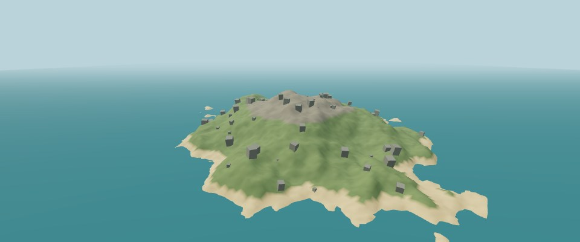

# Roamwright

[](https://www.npmjs.com/package/roamwright)
[](https://github.com/enestaylan/roamwright/actions/workflows/test.yml)

Roamwright is a modular Three.js engine for procedural worlds in the browser. Generate terrain from a seed, batch colored primitives into meshes, and move a camera through walkable or flyable spaces. A worker pool can prepare geometry while the renderer draws the current frame.



## Install

```sh
npm install roamwright
```

npm resolves the Three.js peer in a new project. If you already use Three.js, the supported versions are **0.170.0** and **0.187.0**. To select one explicitly, run `npm install roamwright three@0.187.0`. The renderer requires WebGL 2.

## Run the island example

With Node.js, npm and Python 3 installed, run the following commands.

```sh
git clone https://github.com/enestaylan/roamwright.git
cd roamwright
npm ci
npm run demo
```

Open [the island at seed 42](http://localhost:8080/examples/?seed=42). Drag to orbit and scroll or pinch to zoom. Change the integer in `?seed=42` to generate another island, or share the seed to reproduce the same coastline and rock placement. The [example source](examples/island.js) shows how to generate the terrain, batch the rocks and redraw on camera movement or resize.

## Render your first mesh

Use an ES module bundler, or provide a browser import map as in the example. Supply a canvas with a CSS width and height.

```js
import * as THREE from 'three';
import { createRenderContext, GeometryBuilder } from 'roamwright';

const canvas = document.querySelector('canvas');
const { renderer, scene, camera, worldGroup } = createRenderContext(canvas);
const blocks = new GeometryBuilder();
blocks.box(0, 0, 0, 2, 3, 2, [0.3, 0.55, 0.44]);
blocks.mesh(new THREE.MeshBasicMaterial({ vertexColors: true }), worldGroup, false);

renderer.setSize(canvas.clientWidth, canvas.clientHeight, false);
camera.aspect = canvas.clientWidth / canvas.clientHeight;
camera.updateProjectionMatrix();
camera.position.set(6, 4, 6);
camera.lookAt(0, 1, 0);
renderer.render(scene, camera);
```

## Modules

| Import from `roamwright/` | Use |
| --- | --- |
| `math/noise.js`, `math/random.js`, `math/curve.js` | Create independent seeded noise fields, resumable random streams and evenly spaced spline samples. These modules also run in workers. |
| `geometry/builder.js`, `geometry/primitives.js` | Transform and merge primitives, produce typed vertex buffers, or build a Three.js mesh. Colors passed to the builder are linear RGB. |
| `geometry/instances.js`, `rendering/piece-batch.js` | Draw repeated geometry with instancing or collect changing pieces into a GPU batch. |
| `motion/spaces.js`, `motion/player.js` | Give a space terrain height, decks and colliders. Set the controller's input axes, call `update(deltaSeconds)`, then `applyCamera(camera)`. Distances are in metres. |
| `runtime/pool.js`, `runtime/worker.js` | Register named jobs on a module worker and send work from the page. Typed-array buffers in results transfer back to the caller. |
| `rendering/context.js`, `rendering/world-matrices.js` | Set up WebGL2, a camera, a scene and world group. Optionally track static transforms once per frame before drawing. |
| `rendering/post.js`, `rendering/taa.js`, `rendering/dof.js` | Compose HDR passes, temporal antialiasing, depth of field, exposure and upscaling. The application supplies its camera, effect scene and sky occlusion mask. |
| `runtime/gpu-timing.js`, `runtime/quality-fit.js`, `runtime/quality-store.js` | Measure GPU work, adapt quality and persist a visitor's settings in a storage namespace chosen by the application. |

For geometry generated off the main thread, call `builder.parts(true)` in the worker and `geometryOf(parts)` on the page. This path frees static CPU-side attributes after upload. Keep the seed or source data if your application needs to regenerate meshes after a context loss.

## Contributing and license

See the [contributor guide](CONTRIBUTING.md) for local checks and release instructions. Use [GitHub Issues](https://github.com/enestaylan/roamwright/issues) for bugs and feature requests, or [report a vulnerability privately](https://github.com/enestaylan/roamwright/security/advisories/new).

Roamwright is distributed under the [MIT license](LICENSE). Notices for adapted components are in [licenses](licenses).
