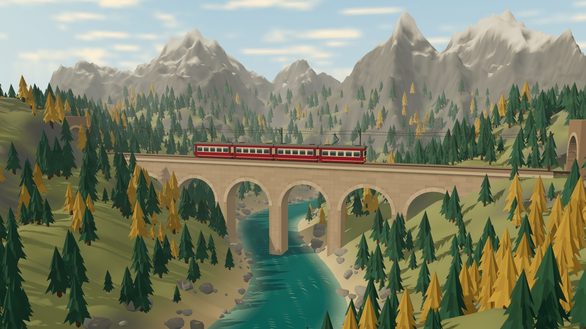

# Roamwright

[](https://www.npmjs.com/package/roamwright)
[](https://github.com/enestaylan/roamwright/actions/workflows/test.yml)

Roamwright is a procedural worldbuilding engine built on top of Three.js. It gives you reusable systems for turning a 3D scene into a world you can explore. You define the landscape once and use the same terrain to shape riverbanks, place scenery and guide characters over uneven ground. First-person walking and flight, crowd animation, weather and day–night lighting can all be used in your own Three.js scene.



**Alpine viaduct.** One height field shapes the riverbed and snowy ridges and determines where the conifers take root. Eight copies of an arch profile form the viaduct. The stonework, rails and overhead wires share one mesh. The four-car electric train moves as a separate mesh. Choose Valley, Trackside or Riverbank and select **Run train** to watch it cross. [Explore the example source](examples/viaduct.js).

## Building an explorable world

- **Landscapes and structures.** Generate repeatable mountain ranges, eroded slopes and rock outcrops. Terrain-aware placement keeps scenery on the ground. Buildings and bridges can use modular geometry and tileable stone, timber and roof textures.
- **Water, light and weather.** Rivers support directional flow, lakes support reflections, and water surfaces respond to rain with ripples. Volumetric clouds, sun and moon cycles, wind and haze let the same landscape take on different weather and lighting conditions.
- **Characters and exploration.** Bipeds and quadrupeds have procedural gaits, and crowds can follow daily routes. First-person movement covers walking, jumping and flight, including collision checks and support for raised surfaces such as bridge decks.
- **Large scenes.** Background geometry generation, batched scenery, instanced crowds, distance-based levels of detail and adaptive rendering quality help manage the cost of dense forests, crowds and long views.

## Install

```sh
npm install roamwright
```

npm resolves the Three.js peer in a new project. If you already use Three.js, the supported versions are **0.170.0** and **0.187.0**. To select one explicitly, run `npm install roamwright three@0.187.0`. The renderer requires WebGL 2.

## Built with Roamwright

[Malazan](https://enestaylan.com/malazan/) is an explorable world built with Roamwright. Fly over Darujhistan, Pale, and the Rhivi Plain from *Malazan Book of the Fallen*.

The shader compilation schedule accepts a subtree or an array of disjoint subtrees in one lighting environment. During a loading screen, `await warmShaders(roots, {blocking: true})` passes the blocking flag to `beginCompiles(root, warmed, blocking)` so the application can submit the batch in parallel. The default keeps the application’s incremental scheduling during play.

## Examples

| Live example | What the example shows | Source |
| --- | --- | --- |
| [Alpine viaduct](https://enestaylan.github.io/roamwright/examples/viaduct.html) | Watch an electric train cross eight stone arches from the valley, trackside or riverbank. | [viaduct.js](examples/viaduct.js) |
| [Seeded island](https://enestaylan.github.io/roamwright/examples/?seed=42) | Seeded noise shapes the coastline, and a single mesh holds the rocks scattered along the shore. | [island.js](examples/island.js) |

### Run locally

With Node.js, npm and Python 3 installed, run the following commands.

```sh
git clone https://github.com/enestaylan/roamwright.git
cd roamwright
npm ci
npm run demo
```

Open the address printed in the terminal for the example you want to explore. Drag to orbit and scroll or pinch to zoom. Change the integer after `?seed=` to generate a different landscape.

## Render your first mesh

Use an ES module bundler, or provide a browser import map as in the example. Supply a canvas with a CSS width and height.

```js
import * as THREE from 'three';
import { createRenderContext, GeometryBuilder } from 'roamwright';

const canvas = document.querySelector('canvas');
const { renderer, scene, camera, worldGroup } = createRenderContext(canvas);
const blocks = new GeometryBuilder();
blocks.box(0, 0, 0, 2, 3, 2, [0.3, 0.55, 0.44]);
blocks.mesh(new THREE.MeshBasicMaterial({ vertexColors: true }), worldGroup, false);

renderer.setSize(canvas.clientWidth, canvas.clientHeight, false);
camera.aspect = canvas.clientWidth / canvas.clientHeight;
camera.updateProjectionMatrix();
camera.position.set(6, 4, 6);
camera.lookAt(0, 1, 0);
renderer.render(scene, camera);
```

## Modules

Import modules by path, for example `roamwright/geometry/builder.js`.

| Area | Main modules |
| --- | --- |
| Seeded generation | `math/noise.js`, `math/random.js` |
| Geometry and terrain | `geometry/builder.js`, `geometry/heightfield.js`, `geometry/terrain-chunks.js` |
| Static geometry assembly | `geometry/builder-frame.js`, `geometry/builder-cells.js` |
| Rendering | `rendering/context.js`, `rendering/sky.js`, `rendering/water-material.js` |
| Movement | `motion/player.js`, `motion/biped-stride.js` |
| Background jobs | `runtime/pool.js`, `runtime/worker.js`, `runtime/grid-rows.js` |

## Contributing and license

See the [contributor guide](CONTRIBUTING.md) for local checks and release instructions. Use [GitHub Issues](https://github.com/enestaylan/roamwright/issues) for bugs and feature requests, or [report a vulnerability privately](https://github.com/enestaylan/roamwright/security/advisories/new).

Roamwright is distributed under the [MIT license](LICENSE). Notices for adapted components are in [licenses](licenses).
